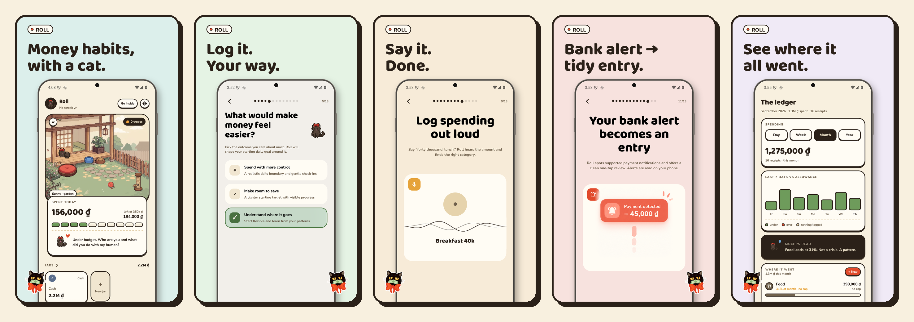
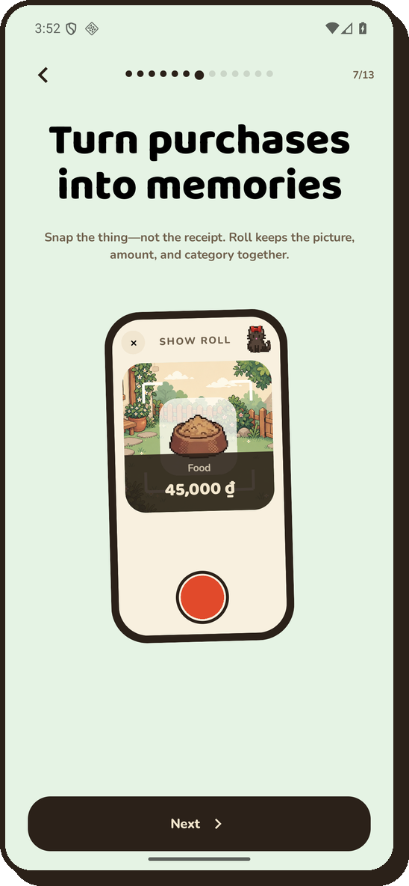
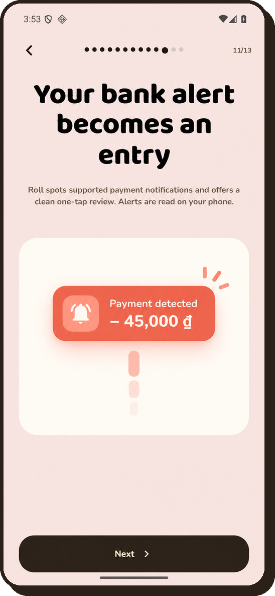
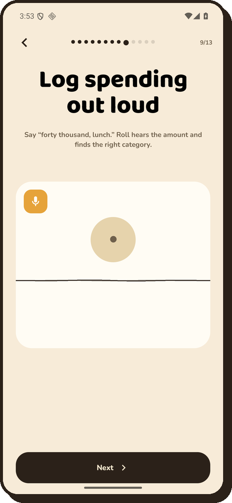
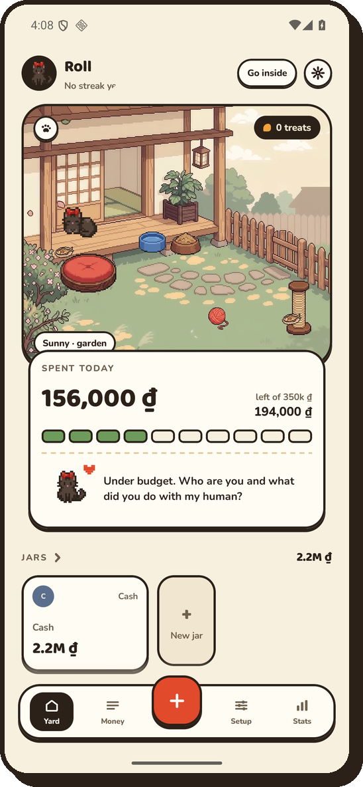
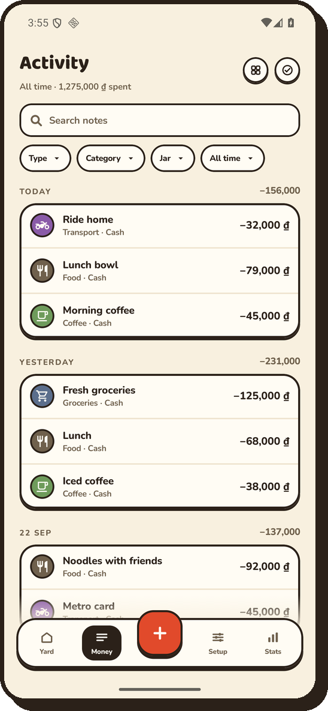
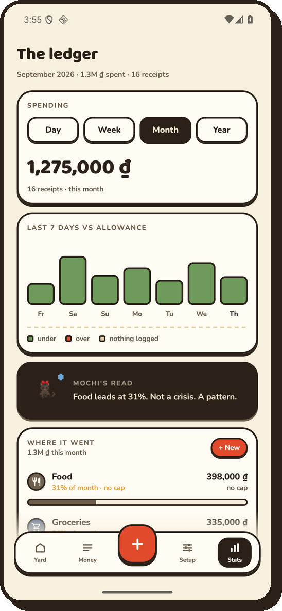
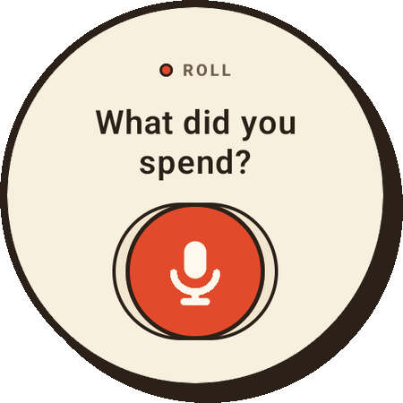
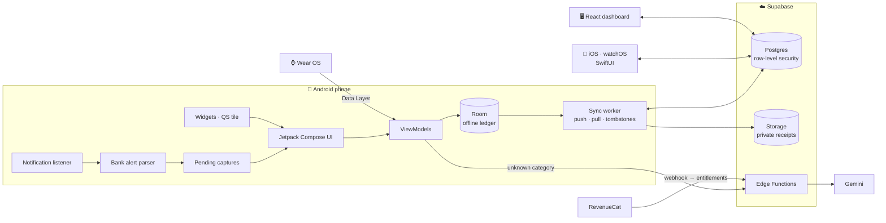

# Roll

**Money habits, with a cat.**
A personal expense tracker where logging takes seconds: snap it, say it, or let your bank alert do it.

 

 

> [!NOTE]
> This repo is a **showcase**. Roll's source code is private; here you'll find what it does, how it's built, and how it got there.

## Why Roll

Most budgeting apps fail at the boring part: actually writing things down. Roll attacks that first.
Every way of logging is built to finish in a couple of seconds, and a sharp-tongued black cat named
Roll keeps you honest with a **daily allowance**, **treats** for staying under it, a **streak**, and a
garden of pixel cats you unlock as your habits grow. Go over budget and Roll will roast you
(gently, spicy, or savage: your choice).

 

<table>
<tr>
<td width="42%" align="center"></td>
<td>

### 📸 Snap it

A Locket-style **camera-first log**: shoot the thing you bought (not the receipt), type the amount,
add a note, done. Photos and short video clips become a scrollable wall of past purchases, so your
spending reads like a diary instead of a spreadsheet.

- Square viewfinder, front or back camera, mirror kept the way the preview showed it
- Category and jar as pills right on the photo
- Swipe down from the camera through every past receipt, filterable by category
- Fingerprint-gated history when opened from a widget

</td>
</tr>
<tr>
<td>

### 🔔 Let the bank do it

Roll reads **supported bank payment notifications on the phone**, money in and money out, and
turns each one into a one-tap entry. Amount and time come from the alert; you just say what it was.

- Each alert gets its own notification, grouped under a *"3 waiting"* summary
- Tap to log, × to dismiss, or confirm from your watch
- Parsing happens entirely on-device; nothing is saved until you confirm
- Unit-tested parser across bank formats, spends and incoming transfers

</td>
<td width="42%" align="center"></td>
</tr>
<tr>
<td width="42%" align="center"></td>
<td>

### 🎙️ Say it

*"Breakfast 40k."* *"Bốn mươi nghìn ăn sáng."* Roll's voice parser understands amounts and notes in
**English and Vietnamese**, including shorthand like `40k` and VND-in-thousands.

- A local keyword matcher picks the category instantly
- Anything it can't place goes to a **Gemini** classifier behind a Supabase Edge Function, with the
  API key kept server-side and a rate limit enforced in Postgres
- Works from the phone, the Quick Settings tile, or the watch

</td>
</tr>
<tr>
<td>

### 🐈‍⬛ The yard

Your home screen is a pixel-art garden. Today's spend, what's left of your allowance, your jars, and
Roll's verdict on your day. Stay under budget to earn treats, keep a streak, and unlock new cats.

- Pick your companion; more cats arrive as habits grow
- Roll nudges you through the day, two times at most, never spammy
- Payment reminders 3 days before, on the day, and once when overdue

</td>
<td width="42%" align="center"></td>
</tr>
<tr>
<td width="42%" align="center"></td>
<td>

### 💸 Money, jars & people

Everything you need for real-life money, still in a few taps.

- **Jars** for cash, cards and wallets, each in **its own currency**, with exchange moves between them
- **Credit cards** with limits; **loans** with repayment plans (flat or monthly rate)
- **Split a bill** with friends: shares typed like amounts, the last share fills itself
- **People**: who owes whom, paid back in parts, in any currency
- Bulk edit: long-press to move many entries to a new date, category or jar

</td>
</tr>
<tr>
<td>

### 📊 See where it went

Day, week, month and year views, the last seven days against your allowance, category breakdowns,
and Roll's one-line read of your month (*"Food leads at 31%. Not a crisis. A pattern."*).

- CSV export and full local backup/restore, including photos and pet progress
- A React web dashboard reads the same synced ledger

</td>
<td width="42%" align="center"></td>
</tr>
<tr>
<td width="42%" align="center"></td>
<td>

### ⌚ On your wrist, on your home screen

- **Wear OS** companion: dictate or key in an amount, your phone saves it
- **Widgets**: today's spend, one-tap category buttons, last purchase
- **Quick Settings tile** to log from anywhere
- A native **iOS + watchOS** port in SwiftUI, with WidgetKit widgets and a Lock Screen allowance gauge

</td>
</tr>
</table>

 

Roll is **offline-first**: the phone's database is the source of truth, and the app is fully usable
without an account. Signing in with **Roll Pro** adds sync between devices and receipt-photo backup.

| Layer | Stack |
| :--- | :--- |
| **Android** | Kotlin, Jetpack Compose, Room, WorkManager, CameraX, Credential Manager (Google sign-in), Biometric, Android Keystore |
| **Wear OS** | Jetpack Compose, Wearable Data Layer |
| **iOS / watchOS** | SwiftUI, WidgetKit, StoreKit via RevenueCat, Sign in with Apple; core logic in a Foundation-only Swift package |
| **Backend** | Supabase: Postgres with RLS, Auth (email OTP, Google, Apple), Storage, Deno Edge Functions |
| **AI** | Gemini for category classification, behind an Edge Function with a Postgres rate limiter |
| **Billing** | RevenueCat → webhook → server-side entitlements |
| **Web** | React 19, Vite, Tailwind |
| **Design** | Custom "sticker paper" system: warm paper, ink outlines, hard shadows, Baloo 2 + Nunito, pixel cats |

 

A few problems that were more interesting than they look:

<b>Offline-first ids that survive the first sync</b>

 

Everything you create on the phone exists immediately, before any server has seen it. New rows get
**negative local ids** (−1, −2, …); when a row is first pushed, the server's id replaces it and a
remap pass rewrites every reference: transactions, plans, the remembered "last jar" and "last
category" preferences. Without Pro, rows never sync, so every part of the app has to treat a
negative id as a perfectly valid one. (A bug where a few readers didn't is exactly how the bank-alert
screen once kept defaulting to *Cash*.)

<b>A sync that never eats your data</b>

 

Deletes travel as **tombstones** written by SQLite triggers. A subtle trap: on Android, `INSERT OR
REPLACE` is a delete plus an insert, so every pull fired the delete trigger and left a tombstone for
a row that was still there. The next push deleted it on the server; the pull after that removed it
locally. The fix lets an insert take back its own row's tombstone. Reproduced against a local
Supabase stack, then verified with three syncs in a row keeping every row on both sides.

<b>Multi-user from a single-user schema</b>

 

Roll started as one person's ledger. Going multi-user meant every table got an owner column that
**defaults to the signed-in user** and **row-level security** on every table, so no client query can
see another user's rows. Signing in on a phone that already has a ledger merges it into *your*
account, and only yours. Switching accounts empties the phone first.

<b>Money in many currencies</b>

 

Amounts are stored in the minor units of a **home currency**, with each entry keeping its original
currency, amount and rate. Jars can hold their own currency (a wallet of euros), and moving money
between currencies is an exchange with two figures. Typing respects each currency's conventions:
`40` means 40,000 ₫ in VND shorthand but €40.00 in euros.

<b>Security and privacy by default</b>

 

- Session tokens are sealed with **AES-GCM under an Android Keystore key**; a copied prefs file holds only ciphertext
- Bank notifications are parsed **on-device**; nothing leaves the phone unless you confirm and sync
- The Gemini key never ships in the app; the Edge Function is **rate-limited** in Postgres
- Receipt photos live in a **private bucket**, one folder per user; uploads require Pro server-side
- In-app **account deletion** that removes server data, as the Play policy requires

 

Six weeks, from an empty scaffold to a store-ready app on four platforms.

| When | Milestone |
| :--- | :--- |
| **Sep 14** | Scaffold, then a full redesign around Roll: sticker UI, the yard, treats and roasts |
| **Sep 23 – 25** | Camera-first photo log and money wall, widgets, Vietnamese localization, onboarding tour, Play Store prep, Locket-style camera with video receipts, logging streak |
| **Sep 30 – Oct 1** | Multi-currency jars and exchanges, split bills, people and IOUs, credit cards and loans with repayment plans, **iOS app** |
| **Oct 6** | Payment reminders, Roll's daily nudges, **accounts and sync between phones**, receipt photo backup, multi-user with RLS |
| **Oct 22** | **Roll Pro**: RevenueCat paywall, server-side entitlements, Apple sign-in and iOS billing, account deletion, sealed tokens. Bank alerts catch income too; bulk edit |
| **Oct 23 – 24** | App icon fitted to the adaptive safe zone; bank-alert logging starts on the note and remembers your jar |

All 22 pull requests

 

| # | Date | Change |
| --: | :--- | :--- |
| 1 | Sep 23 | Photo log: camera-first logging, money wall, widgets, Vietnamese localization |
| 2 | Sep 24 | Play Store release prep, onboarding tour, and policy fixes |
| 3 | Sep 24 | Pending-capture notification: dismiss action, photo-log tap-through, double-log fix |
| 4 | Sep 24 | Backup: account icons, avatar, settings and pet progress |
| 5 | Sep 24 | Play Store listing package, publish plan, onboarding hero art |
| 6 | Sep 25 | Locket-style camera, video receipts, Move jar edits, logging streak |
| 7 | Sep 30 | Currencies, split bills and people; iOS app |
| 8 | Sep 30 | Open animation, garden poster frames, fingerprint-gated quick-log history |
| 9 | Oct 1 | Splits take the whole bill out of the jar; split tag on logs |
| 10 | Oct 1 | People: pay debts in parts, IOUs through a jar, any currency |
| 11 | Oct 1 | Jars hold their own currency; exchange moves |
| 12 | Oct 1 | People & credit: one tab, cards and loans with plans |
| 13 | Oct 6 | Payment reminders |
| 14 | Oct 6 | Sync people, debts, payments and plans |
| 15 | Oct 6 | Roll's nudges through the day |
| 16 | Oct 6 | Accounts, sync between phones, photo backup, multi-currency dashboard |
| 17 | Oct 22 | Pro for sale, account deletion, sealed tokens, updated policy |
| 18 | Oct 22 | Store launch: Pro, accounts, iOS billing + Apple sign-in, sync fixes |
| 19 | Oct 22 | Money tab splits, bank alerts with income, restore fixes, camera setting |
| 20 | Oct 22 | Front-camera photos keep the preview's mirror |
| 21 | Oct 23 | App icon: fit the cat in the safe zone |
| 22 | Oct 24 | Bank alerts: start on the note, keep the last jar |

 

| 📅 6 weeks | 🔀 22 PRs | 📝 162 commits | 🧩 5 platforms |
| :---: | :---: | :---: | :---: |
| **~29.5k** lines of Kotlin | **~14k** lines of Swift | **14** SQL migrations | **3** Edge Functions |

 

---

Designed and built by **[Bảo Trương](https://github.com/baotrq)**
Screenshots use demo data. Roll is a personal-finance tracker; it does not provide banking, payments, lending or financial advice.

